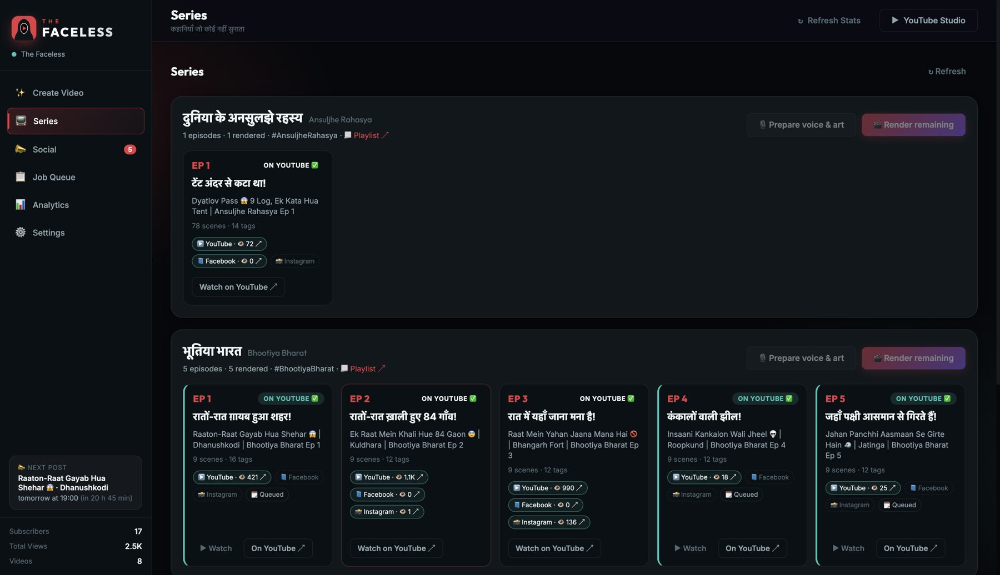
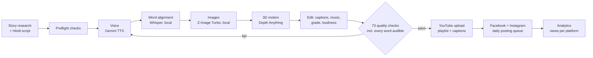
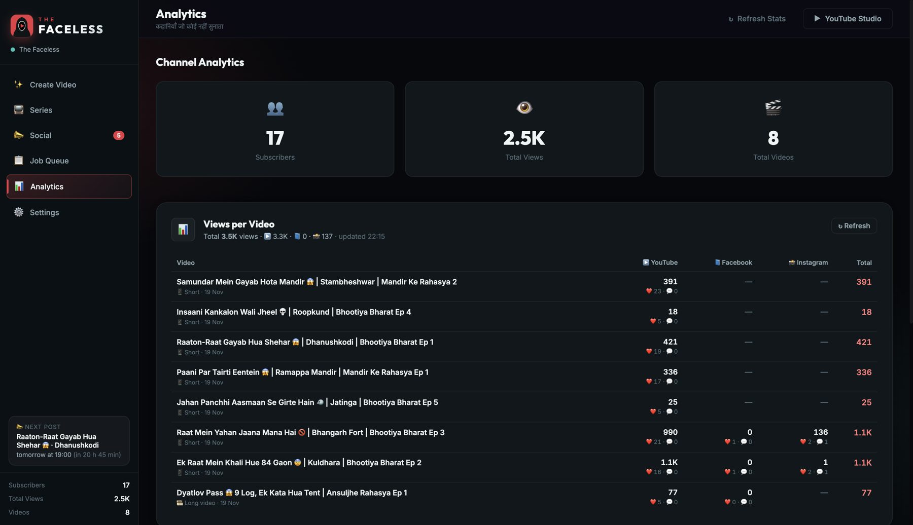

# The Faceless Studio

**An end-to-end pipeline that researches, writes, voices, illustrates, edits, checks and publishes
Hindi mystery videos, from a story idea to YouTube, Facebook and Instagram, with almost no manual
work.** It runs on a single Apple Silicon Mac, uses free tiers and local models, and powers the
YouTube channel [**The Faceless (@thefacelessindia)**](https://www.youtube.com/@thefacelessindia).



## What it produces

Three running series, all generated by this pipeline:

| Series | Format | Example |
|---|---|---|
| **भूतिया भारत** (Bhootiya Bharat): haunted places of India | Shorts, 1080×1920 | Kuldhara, Bhangarh, Roopkund, Jatinga, Dhanushkodi |
| **मंदिर के रहस्य** (Mandir Ke Rahasya): temple mysteries | Shorts | Ramappa (floating bricks), Stambheshwar (temple that vanishes into the sea) |
| **दुनिया के अनसुलझे रहस्य** (Ansuljhe Rahasya): unsolved mysteries | 7-minute anime-style long videos, 1440p | Dyatlov Pass |

Each video has Hindi narration, burned-in captions, AI illustrations with 3D camera motion,
weather effects, music, and a thumbnail, and is uploaded with title, tags, chapters and playlist.

## How it works



1. **Script.** Claude Code skills (`.claude/skills/content-writer`, `dialogue-writer`) research a
   story, fact-check it, and write a scene-by-scene Hindi script as JSON: narration, image
   prompts, ambience, title, tags. Writing rules learned from storytelling research (hook in the
   first 3 seconds, open loops, "but/therefore" scene links, numbers spelled out) are enforced by
   a script checker.
2. **Voice.** One Gemini TTS take per episode (voice *Charon*), so the voice stays identical
   across scenes. Local Whisper (MLX) aligns every word and cuts the take into scenes at the
   quietest point between words, never mid-word.
3. **Pictures.** Z-Image Turbo (4-bit, MLX) generates every illustration locally (~75 s per image).
   Depth Anything V2 turns each still into a 3D parallax camera move; Real-ESRGAN upscales the
   anime long videos.
4. **Edit.** MoviePy + ffmpeg assemble scenes with dissolves, burned-in Hindi captions timed to
   the words, weather effects (snow, rain, fog, flicker), music ducked under the voice, a colour
   grade and -14 LUFS loudness.
5. **Quality gate.** `pipeline/qa.py` runs a 73-item checklist (script, voice, visuals,
   captions, final video). `pipeline/word_check.py` transcribes **every scene of the finished
   mix** and fails the render if any script word is masked by music or effects. Nothing is
   uploaded until everything passes.
6. **Publish.** YouTube Data API: resumable upload, playlist, caption track, Shorts links.
   Meta Graph API: Facebook Reels and Instagram Reels from a daily 7 PM posting queue, with
   captions and hashtags built from the YouTube metadata.
7. **Measure.** The dashboard pulls views, likes and comments per video from YouTube, Facebook
   and Instagram.



## Tech stack

| Area | Tools |
|---|---|
| Dashboard | Flask, vanilla JS/CSS (`server.py`, `static/`) |
| Script writing | Claude Code skills, Gemini (fallback: NVIDIA-hosted LLM) |
| Voice | Gemini TTS (`gemini-3.8-flash-tts`) |
| Alignment, word checks | Whisper Large v3 Turbo on MLX |
| Images | Z-Image Turbo, 4-bit MLX, on-device |
| Motion | Depth Anything V2 (parallax), Real-ESRGAN (upscale) |
| Video | MoviePy 2, ffmpeg |
| Publishing | YouTube Data API v3, Meta Graph API v21 (Facebook + Instagram) |
| Background service | macOS launchd (`service.sh`) |

Everything runs on an M-series Mac with 16 GB of memory. GPU-heavy jobs never run at the same
time (one render at a time, image model unloaded before upscaling).

## Project layout

```
server.py                  Flask dashboard + render queue + social posting scheduler
render_series.py           Renders a series episode by episode (resumable)
service.sh                 Install/run the studio as a macOS background service
config.py                  Models, channel, video sizes, API settings
pipeline/
  script_generator.py      Topic -> script (non-series videos)
  gemini_voice.py          Gemini TTS takes, splicing, per-scene voice checks
  align.py                 Whisper word alignment, scene cuts
  ai_image.py              Prompt styling + Z-Image worker (zimage_worker.py)
  parallax.py, upscale.py  Depth-based camera motion, Real-ESRGAN
  templates.py             Looks: grades, captions style, ambient weather, wind
  video_builder.py         Assembly: Shorts and chaptered long videos
  qa.py, word_check.py     The quality checklist and the every-word check
  youtube_uploader.py      Upload, playlists, captions, channel stats
  meta_uploader.py         Facebook/Instagram Reels + posting queue
  stats.py                 Views per video across the three platforms
scripts/<series>/          Episode scripts (JSON) and series settings
.claude/skills/            Script-writing skills, references and checkers
PRODUCTION.md              Production workflow, checks, troubleshooting
SETUP.md                   Installation and API keys
```

## Getting started

Requirements: macOS on Apple Silicon, Python 3.9+ (plus a Python 3.12 env for the image model),
ffmpeg.

```bash
git clone https://github.com/iam-devesh/youtube-automation.git
cd youtube-automation
pip install -r requirements.txt
cp .env.example .env        # add your keys (see SETUP.md)
python3 server.py           # dashboard at http://localhost:5055
```

Keys used (all have free tiers): Gemini API, YouTube Data API OAuth client
(`client_secrets.json`), optional Pexels, optional Meta app + Page token for Facebook/Instagram.
Secrets live only in `.env`, `client_secrets.json` and `token.json`, which are git-ignored.

Full setup: [SETUP.md](SETUP.md). How an episode moves from script to upload, and what to do
when a check fails: [PRODUCTION.md](PRODUCTION.md).

## Roadmap

- **Real AI video clips** for key shots, generated on Kaggle's free GPUs (Wan 2.2
  image-to-video), fully automated, with today's motion as the fallback.
- **A "cinematic documentary" format for long videos:** cold open, case-file chapters, theory
  scoreboard, code-generated maps, timelines and evidence boards, a second voice for
  dramatized lines.
- **YouTube Analytics retention curves** in the dashboard, to see exactly where viewers drop off.

## Development notes

Built with [Claude Code](https://claude.com/claude-code) as an AI pair programmer. Project rules
for it (for example: every narrated word must be audible in the final mix) are in
[CLAUDE.md](CLAUDE.md).
